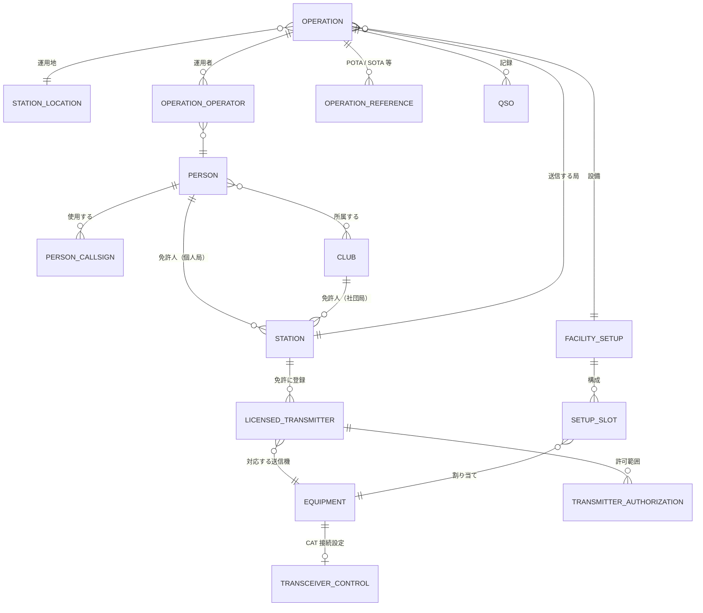

# データモデル

状態: 提案（決定事項 D6・D7・D10・D11 を反映。決定事項は [00_DEVELOPMENT_POLICY.md](00_DEVELOPMENT_POLICY.md) を参照）

## 1. 設計方針

1. **「誰として」「どこで」「何で」「誰が」を分ける。** 局（Station）、運用地（Location）、設備（Facility）、運用者（Person）を独立したエンティティにする。同じ移動キットを個人局と社団局の両方、別の運用地で使い回せる。
2. **一人が複数のコールサインを持つことを前提にする。** 個人局の複数免許、社団局、記念局、移動運用、コールサインの変遷、海外免許を扱う。
3. **QSO には記録時点の値をコピーとして保存する。** プロファイルを後で編集しても、過去の QSO は変わらない。参照用の ID も併せて保存する。
4. **項目の意味は ADIF 3.x に揃える。** 内部の保存形式は自由だが、項目名と意味は ADIF の語彙を使う。
5. **時間で変わるものには有効期間を持たせる。** 免許、登録設備、コールサインの使用期間、機器の構成は変更履歴を残し、「その日時に有効だった値」で過去ログを検証できるようにする。
6. **周波数は整数 Hz、時刻は UTC で保持する。** 表示時にだけ地域の形式へ変換する。

## 2. 全体像

## 3. エンティティ

### 3.1 Person（運用者）

| 項目 | 説明 |
|---|---|
| PersonId | 内部 ID |
| Name | 氏名（表示用、任意） |
| PrimaryCallsign | 普段使う個人コール（表示用の既定値） |

### 3.2 PersonCallsign（運用者が使うコールサイン）

一人が持つ複数のコールサインと、その変遷を表す。

| 項目 | 説明 |
|---|---|
| Callsign | コールサイン（例: JA1XXX、KH0/JA1XXX で使う基本コール、W の免許） |
| Kind | 個人局 / 海外免許 / 旧コール |
| ValidFrom / ValidTo | 使用期間 |
| SupersededBy | 新しいコールへの紐付け（旧コールの場合） |

「自分の全コールでの交信」を集計するときは、この一覧を使う。

### 3.3 Club（クラブ）

| 項目 | 説明 |
|---|---|
| ClubId | 内部 ID |
| Name | クラブ名 |

### 3.4 Station（無線局 = 免許）

法的に「誰として送信するか」を表す。

| 項目 | 説明 |
|---|---|
| StationId | 内部 ID |
| Callsign | 局のコールサイン |
| Kind | 個人局 / 社団局 / 記念局・特別局 / 海外局 |
| LicenseeRef | 免許人（Person または Club） |
| LicenseNumber | 免許の番号（任意） |
| ValidFrom / ValidTo | 免許の有効期間 |
| ExternalAccounts | LoTW 証明書、eQSL、Club Log、QRZ、POTA などのアカウント参照。資格情報そのものは OS の資格情報ストアに置く |

### 3.5 LicensedTransmitter（免許に登録された送信機）

日本の局免許に記載される「第 N 送信機」に相当する。

| 項目 | 説明 |
|---|---|
| StationId | どの局の免許か |
| Number | 第 N 送信機の番号 |
| EquipmentId | 対応する Equipment（送信機） |
| ConformityId | 技適番号または保証番号 |
| ValidFrom / ValidTo | 登録・取消の日付 |

### 3.6 TransmitterAuthorization（送信機ごとの許可範囲）

| 項目 | 説明 |
|---|---|
| Band | 許可周波数帯 |
| EmissionClass | 電波の型式（例: A1A、J3E） |
| MaxPowerW | 空中線電力の上限 |

モード（FT8、RTTY など）と電波の型式の対応は、年次で更新できる別の対応表として持つ。

### 3.7 StationLocation（運用地）

「どこから送信するか」を表す。

| 項目 | 説明 |
|---|---|
| LocationId | 内部 ID |
| Name | 表示名（例: 自宅、別荘、○○公園） |
| GridSquare | グリッドロケーター |
| Latitude / Longitude | 緯度・経度（任意） |
| DXCC / CQZone / ITUZone | エンティティとゾーン |
| Prefecture / CityCode | 都道府県と、市・郡・区のコード。ADIF の `MY_STATE` / `MY_CNTY` と同じ値（例：01 / 0101）。区分（JCC / JCG / 区）は参照データで決める（[ADR 0005](adr/0005-japanese-subdivision-reference-data.md)） |
| PortableSuffix | 移動の表示（例: /3、/P） |
| IsPortable | 固定 / 移動 |

### 3.8 Station Facility（設備）

「何で送信するか」を表す。機器の台帳（Equipment）と、機器の組み合わせのプリセット（Facility Setup）からなる。

#### Equipment（機器）

| 項目 | 説明 |
|---|---|
| EquipmentId | 内部 ID |
| Kind | トランシーバ / リニアアンプ / アンテナ / チューナー / オーディオ IF / キーヤー / ローテーター / アンテナ切替器 |
| Maker / Model / Serial | メーカー、型番、シリアル |
| OwnerRef | 所有者（Person または Club） |
| Capabilities | 対応バンド、最大出力、対応モード |
| Status | 使用中 / 保管 / 廃棄（有効期間付き） |

種類ごとの追加属性:

| 種類 | 追加属性 |
|---|---|
| トランシーバ | TransceiverControl: HamlibComponentの接続設定（機種、ポート、通信速度、PTT 方式） |
| アンテナ | 形式（八木、ダイポール、垂直など）、対応バンド、利得、地上高、向き（固定アンテナの場合） |
| リニアアンプ | 出力の上限、対応バンド |
| キーヤー | 種類（WinKeyer など）、接続設定 |

#### FacilitySetup（設備のプリセット）

| 項目 | 説明 |
|---|---|
| SetupId | 内部 ID |
| Name | 例: 自宅 HF、V/UHF、POTA 移動キット、SO2R |
| DefaultStationId / DefaultLocationId | 既定の局と運用地（任意） |
| Slots | 機器の割り当て（下表） |
| DefaultPowerW | 既定の出力 |

| SetupSlot | 説明 |
|---|---|
| Role | Radio1 / Radio2 / Amplifier / Keyer / AudioInterface / Rotator |
| EquipmentId | 割り当てる機器 |
| BandAntennaMap | バンドごとの使用アンテナ（Radio のスロットのみ） |

### 3.9 Operation（運用）

日常運用、コンテスト、POTA、SOTA などの運用単位。

| 項目 | 説明 |
|---|---|
| OperationId | 内部 ID |
| Kind | 日常 / コンテスト / POTA / SOTA / その他 |
| StationId | 送信する局 |
| TransmittedCallsign | 実際に送信するコール（例: JA1XXX/3）。Station のコールと Location の移動表示から作り、手動で上書きもできる |
| LocationId | 運用地 |
| SetupId | 設備のプリセット |
| Operators | 運用者の一覧（マルチオペ、社団局のゲストオペ） |
| References | POTA 公園番号（複数可）、SOTA サミット番号など |
| ContestDefinition / Category | コンテストの規約定義と参加部門（コンテストの場合） |
| StartUtc / EndUtc | 期間 |

### 3.10 QSO

QSO には記録時点の値をコピーとして保存する。

| 区分 | 項目（ADIF 名） | 取得元 |
|---|---|---|
| 交信相手 | `CALL`、`RST_SENT`、`RST_RCVD`、`SRX` / `SRX_STRING`、`NAME`、`QTH`、`GRIDSQUARE`、`POTA_REF`、`SOTA_REF` | 入力・参照 |
| 交信内容 | `QSO_DATE` / `TIME_ON`（UTC）、`FREQ`、`BAND`、`MODE`、`SUBMODE`、`STX` / `STX_STRING`、`CONTEST_ID` | 入力・無線機・Operation |
| 自局 | `STATION_CALLSIGN`、`OPERATOR`、`OWNER_CALLSIGN` | Operation・Station |
| 運用地 | `MY_GRIDSQUARE`、`MY_DXCC`、`MY_CQ_ZONE`、`MY_ITU_ZONE`、`MY_STATE`、`MY_CNTY`、`MY_POTA_REF`、`MY_SOTA_REF`、`MY_SIG` / `MY_SIG_INFO` | Location・Operation |
| 設備 | `MY_RIG`、`MY_ANTENNA`、`TX_PWR` | Facility Setup・無線機 |

内部項目（ADIF 出力時はアプリ独自項目として扱う）:

| 項目 | 説明 |
|---|---|
| QsoId | 衝突しない ID |
| OperationId / StationId / LocationId | 参照用 |
| TransceiverId / AntennaId / AmplifierId | 使用した機器 |
| RadioNumber | Radio1 / Radio2（SO2R） |
| LicensedTransmitterId | 照合に使った登録送信機 |
| Revision | 修正履歴（元の値、修正者、日時、理由）。Omoikane のログエディタの Undo / Redo もこの履歴で実現する |
| Source | 記録の出どころ（手入力、HuginnEngine、WSJT-X、取り込み）と、その取り込み元の識別子 |
| DecodeEvidence | HuginnEngine 由来の場合、生のデコード値・信頼度・補正後の値・補正の根拠。利用者が却下した補正は生の値に戻せる |

日本の行政区分は、ADIF 3.1.8 のコードをそのまま使う（[ADR 0004](adr/0004-adif-import-export.md)、[ADR 0005](adr/0005-japanese-subdivision-reference-data.md)）。

| 区分 | 相手局 | 自局 | 値 |
|---|---|---|---|
| エンティティ | `DXCC` | `MY_DXCC` | 339（Japan） |
| 都道府県 | `STATE` | `MY_STATE` | 01〜47（例：東京 10） |
| 市・郡・区 | `CNTY` | `MY_CNTY` | JCC（例：0101 札幌市、100101 東京都千代田区）、JCG（例：01001 阿寒郡）、区（例：010101 札幌市中央区） |

- コードは文字列として保持し、先頭のゼロを残す。接頭辞（`JCC-` など）は付けない。
- 交信時点のコードを保存し、合併などで変わっても書き換えない。

アプリの中では、QSO を `TQsoRecord`（`Muninn.Core.Qso`）で表す。
- 単位や暦の規則が必要な値は、型付きで持つ：コールサイン、日時、周波数、バンド、モード、出力。
- それ以外の値は、ADIF のフィールド名のまま `OtherFields` に持つ。

### 3.11 SQLite での保存

| 版 | 内容 |
|---|---|
| v1 | `station`、`station_location`、`operation`、`qso`、`qso_field` の 5 つのテーブル（ADR 0003） |
| v2 | `qso` に相手局の所在地 `dxcc`（INTEGER）、`state`、`cnty`（TEXT）を追加 |

残りのエンティティ（Person、Equipment など）は、後の版のマイグレーションで追加する。

- 定義は `src/storage/muninn.storage.schema.pas` にある。
- 列名と単位の決まり、列挙のコードは [ADR 0003](adr/0003-storage-sqlite.md) を参照。

## 4. 規則と検証

| 規則 | 内容 |
|---|---|
| 免許との照合 | バンド・電波の型式・出力（アンプ込み）を、有効な LicensedTransmitter の許可範囲と照合する。範囲外は記録前に警告する |
| 免許の有効期限 | Operation の期間が Station の有効期間外なら警告する |
| 未登録の設備 | 免許に登録されていない送信機で運用しようとしたら警告する |
| 自局コールの明示 | 送信中のコールを画面上部に常に表示し、コールごとに色を変えられる。Operation の切り替え時は確認を入れる |
| 重複チェックの単位 | 「Operation × 送信したコール」で判定する |
| 過去の交信チェックの範囲 | 「このコールでの交信のみ」「自分の全コールでの交信」を切り替えられる |
| 出力の単位 | ADIF、LoTW、JARL 電子ログ、POTA の公園別 ADIF、QSL カード印刷は送信したコール単位で行う。異なる自局コールの QSO が混ざっていたら出力前に止める |
| 取り込み時の割り当て | Hamlog などファイル単位で自局コールを持つデータを取り込むときは、どの Station / Operation に割り当てるかを指定させる |
| コンテストの電力区分 | Facility Setup の出力設定から、JARL の H / M / L / P や海外の HIGH / LOW / QRP を自動で決める |

## 5. 想定ケースと表現方法

| ケース | 表現方法 |
|---|---|
| 個人局を複数持つ（自宅と別荘） | Station を 2 つ。それぞれに LicensedTransmitter と既定の Location |
| 海外の免許（W、KH0） | Kind = 海外局の Station。PersonCallsign で同一人物に紐付ける |
| 社団局をメンバーが運用 | 免許人が Club の Station。Operation の Operators に個人を登録し、QSO の `OPERATOR` に記録 |
| 記念局・特別局 | 有効期間付きの Station |
| 移動運用 | Location の PortableSuffix と、Operation の TransmittedCallsign |
| コールサインの変更 | 旧コールの PersonCallsign に ValidTo と SupersededBy。過去の QSO は当時のコールのまま |
| POTA の複数公園同時運用 | Operation の References に複数の公園番号。出力時に公園ごとのファイルに分ける |
| 移動キットの使い回し | 同じ Facility Setup を、異なる Station / Location の Operation で使う |
| SO2R | Facility Setup に Radio1 / Radio2。QSO に RadioNumber |

## 6. 設備を独立させて得られる機能

1. 免許との照合（第 4 節）
2. 無線機接続の一元管理。CAT 接続設定はトランシーバに一度だけ持たせ、Facility Setup の切り替えで HamlibComponentの接続先も切り替わる
3. 入力の自動化。周波数からバンドを判定し、使用アンテナと出力を自動で入れる
4. POTA / SOTA の移動キットを選ぶだけで、出力・アンテナ・オーディオ IF の設定が揃う
5. アンテナ別・バンド別に、レポート、交信距離、交信数を比較する分析
6. 機器や免許の変更履歴から、その日時に使えた設備で過去ログを検証する

## 7. コンテストと規約パッケージ

| エンティティ | 項目 | 説明 |
|---|---|---|
| RulePackage | PackageId、Name、Version、FormatVersion、Author、ValidFrom / ValidTo、Signature 状態、SHA-256 | 読み込んだ Yata Logic パッケージ（.ylg）。公式 / 自作の区別と署名検証の結果を持つ |
| Operation（コンテスト） | RulePackageId、RulePackageVersion、Category | 使用した規約の版を記録し、過去のログを当時の規約で再計算できるようにする |
| QsoScore | QsoId、IsDupe、Points、Multipliers、RuleIds、Explanation | 規約エンジンの計算結果。QSO 本体とは分けて保存し、再計算で作り直せるようにする |

## 8. プライバシー

| エンティティ | 項目 | 説明 |
|---|---|---|
| Consent | Purpose、State（同意 / 撤回）、GrantedAt / RevokedAt、Version | 目的ごとの同意。目的の例: オンライン同期、PSKReporter 送信、GPS 利用、CW 学習データの保存 |
| ExternalAccount | Service、StationId、CredentialRef | 外部サービスのアカウント。資格情報そのものは OS の資格情報ストアに置き、ここには参照だけを持つ |
| TransmissionLog | Service、Purpose、SentAt、ItemCount、Result | 外部へ送信した記録。利用者が後から確認できるようにする |

同意の撤回時は、該当する目的の送信を止め、必要に応じて外部・エンジン側のデータ削除を要求する。
QSO 記録そのもの（交信相手のコールサインを含む）は、ログの完全性とコンテスト提出の要件があるため、削除権の対象外とし、利用者自身の判断で削除できるようにする。

## 9. 未決事項

- 有効期間付きデータの持ち方（履歴テーブルか、期間付きの行か）。保存方式は SQLite に決定済み（D10）
- アプリ独自項目の ADIF 出力名（`APP_<名前>_<項目>` の形式）
- 電波の型式とモードの対応表の出典と更新方法
- 資格情報（LoTW 証明書のパスワード、各サービスの API キー）を保存する OS ごとの仕組み
