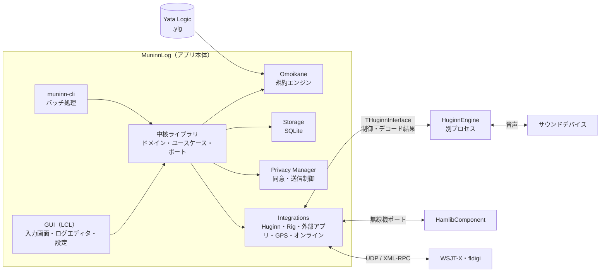

# MuninnLog アーキテクチャ

状態: 提案。方針の正本は [00_DEVELOPMENT_POLICY.md](00_DEVELOPMENT_POLICY.md)。

## 1. 全体構成



依存の向きは「GUI / CLI → 中核 → ポート ← 各実装」とする。中核ライブラリは LCL、OS の API、通信、ファイルに直接依存しない。

## 2. コンポーネント

| コンポーネント | 責務 | 構想書での名前 |
|---|---|---|
| 中核ライブラリ | ドメイン（QSO、プロファイル、Operation）、ユースケース、ポート定義 | — |
| Storage | SQLite への保存、スキーマのマイグレーション、バックアップ、最適化（VACUUM） | `TLoggingSubsystem` |
| Omoikane | Yata Logic の読み込みと検証、重複チェック、得点・マルチ、コンテスト用の出力 | `TPluginManager`、Omoikane |
| 入出力 | ADIF、CSV、Cabrillo、JSON、JARL 電子ログ、Hamlog 取り込み | Omoikane の Import / Export |
| 無線機アダプター | HamlibComponentの呼び出し。周波数・モード・スプリット・PTT の唯一の窓口 | `TRigControlSubsystem` |
| Huginn アダプター | `THuginnInterface` の実装。エンジンの起動・監視・再起動、デコード結果の受信、送信要求 | `THuginnInterface` |
| 外部アプリ連携 | WSJT-X（UDP）、fldigi（XML-RPC）、MMTTY（Windows） | — |
| Privacy Manager | 同意の取得・撤回、外部送信の可否判定、利用者データの書き出し・削除 | `TPrivacyManager` |
| GPS アダプター | NMEA の解析、位置情報（同意が前提） | `TGpsInterface` |
| GUI | 画面と Presenter。UI の状態は UI スレッドだけで更新する | UI Layer |
| muninn-cli | GUI なしでの読込・再計算・検証・出力 | Omoikane の CLI |

## 3. HuginnEngine との境界

### 3.1 推奨する形

HuginnEngine は **別プロセス** として動かす。

- エンジンの異常終了や処理の遅れが、ログ入力と保存を巻き込まない
- エンジンを MuninnLog と別の周期で開発・更新できる
- 将来、別のロギングアプリからも同じエンジンを使える

### 3.2 データの流れ

| 方向 | 内容 | 頻度 |
|---|---|---|
| MuninnLog → Huginn | 起動・停止、使用する音声デバイス、モードと周波数、送信要求（テキスト、マクロ） | 低 |
| Huginn → MuninnLog | デコード結果（生の値、信頼度、補正後の値と補正の根拠）、状態、エラー | 中 |
| Huginn → MuninnLog | ウォーターフォールの表示用データ（間引き済み） | 中（画面の更新周期に合わせる） |
| Huginn → 無線機 | PTT・送信開始は MuninnLog の無線機アダプター経由で要求する | 低 |

**音声データそのものは境界を流さない。** 音声入出力は HuginnEngine が直接持つ。MuninnLog が担うのは、デバイスの選択 UI だけである。

### 3.3 通信仕様に含めるもの

- メッセージの版番号と、互換性のない変更の扱い
- 起動時の能力の照会（対応モード、送信可否、CW 学習機能の有無）
- 生存確認（ハートビート）、タイムアウト、再接続
- 送信の安全規則
  - 送信要求には期限を付ける
  - MuninnLog からの停止指示を最優先にする
  - 通信が途絶えたら送信を止める
- デコード結果の区分：生の観測、信号の確からしさ、複数デコーダの合意、誤り訂正の結果、文脈による補正
- CW 学習データの保存場所と削除指示（Privacy Manager から）

M0 で通信仕様 v1 を合意し、MuninnLog 側は模擬エンジンでテストする。

## 4. 無線機アダプター（HamlibComponent）

無線機制御には、別途開発している **HamlibComponent（Rev.6.0）** を使う（決定事項 D3）。
以下は [README](references/HamlibComponent_README_Rev6.0.md) に基づく。設計書・ソースは未確認。

### 4.1 コンポーネントの要点

| 項目 | 内容 |
|---|---|
| 提供形態 | Lazarus パッケージ（`HamlibComponent.lpk`）。MuninnLog と同じプロセスで動き、Hamlib の共有ライブラリを実行時に動的ロードする |
| 中核 | LCL に依存しない。コンソールプログラムやテストでも使える |
| スレッド | Hamlib のハンドルに触れるのは専用ワーカースレッド 1 本だけ（試験で検証済み）。UI はブロックされない |
| API | `IRigService`（ファサード）を `TRigServiceFactory` から作る。操作は非同期（`SetFrequencyAsync` など）で、結果は値型の結果レコードとしてコールバックに届く |
| 状態の取得 | ポーリング（`EnablePolling`）と `OnFrequencyChanged` イベント、または `CurrentState` のスナップショット |
| 対応範囲 | 周波数、モード、PTT、スプリット、VFO の選択と操作、レベル（S メータ、RF 出力など 38 種）、機能（22 種）、能力の照会、conf トークン |
| エラー | `TRigErrorKind`（未接続、接続失敗、ポート使用中、タイムアウト、非対応など）で分岐する。Hamlib の数値は記録用 |
| 安全性 | 二段タイムアウト（Hamlib の再試行と、固まった I/O を解除する監視スレッド）、適応型サーキットブレーカー、Hamlib の版の検査、タイムアウトの方針（Default / FastUsb / SlowCat / VerySlowCat） |
| 機種の選択 | 実行時のカタログ（`CreateModelCatalog`）から選ぶ。機種番号を埋め込まない |

### 4.2 MuninnLog での使い方

| MuninnLog 側の要素 | HamlibComponent との対応 |
|---|---|
| 無線機ポート（中核が依存する窓口） | `IRigService` を包むアダプター。中核は HamlibComponent の型に直接依存しない |
| Station Facility のトランシーバの接続設定（[03](03_DATA_MODEL.md) 3.8 節） | 機種（カタログの番号と名前の両方を保存）、ポート、タイムアウトの方針、conf トークン（`ptt_type` など） |
| QSO の周波数・モードの自動入力 | `CurrentState` とポーリング。スプリット中は送信周波数を `FREQ`、受信周波数を `FREQ_RX` に記録する。`CurrentFreq` は選択中の VFO の値であり、送信周波数とは限らない点に注意 |
| 接続状態の表示 | `OnConnectionChanged` と `TRigErrorKind` を、UI の「未接続 / 非対応 / ポート使用中 / 一時的な障害」に対応させる |
| 能力の表示 | 空の能力は「非対応」ではなく「未照会」として扱う（README の方針に合わせる） |
| DX のスプリット設定 | `demo2/DxSplitSequence.pas` と同じく、途中で失敗したらスプリットを解除してから失敗を報告する |
| SO2R | 無線機ごとに `IRigService` を 1 つ作る（同一プロセスで複数を使えるかは要確認） |
| 起動時の版の検査 | 検証範囲外の Hamlib を拒否された場合の案内画面を用意する |

### 4.3 MuninnLog 側で補うもの、または確認が必要なもの

| 項目 | 内容 | 対応 |
|---|---|---|
| PTT の送信時間の上限 | README の二段タイムアウトは I/O の保護であり、PTT を押したままになる事態の監視ではない | MuninnLog 側で送信時間の上限を監視し、超えたら PTT を解除する（コンポーネント側に機能があれば利用） |
| CW 送信 | README の対応範囲に `rig_send_morse` 相当が無い | CW キーヤーは WinKeyer または HuginnEngine で行う。必要ならコンポーネントへの追加を検討 |
| Hamlib ライブラリの同梱 | README は利用者が自分でインストールする前提（Windows は DLL の配置、macOS は Homebrew） | 一般利用者向けには MuninnLog に同梱する。macOS はアプリ内に同梱して署名・公証する。読み込み先を環境変数（`VELA_HAMLIB_PATH`）ではなく API で指定できるか確認する。Hamlib は LGPL のため、同梱時の表記と入手方法を整える |
| `cthreads` | Unix では LCL アプリでも `uses` の先頭に必要 | MuninnLog の GUI・CLI の起点で必ず指定する |
| コールバックの届け先 | README の例では UI スレッドに届く | CLI（GUI なし）でどのように届くかを確認する |
| 他のアプリとの無線機の共有 | WSJT-X などと同じシリアルポートは同時に開けない（`rekAccessDenied`） | Hamlib のネットワーク機種（rigctld 経由）で共有する構成を用意する |
| HuginnEngine からの送信 | HuginnEngine は別プロセス。送信要求は MuninnLog の無線機アダプター経由とする（第 3 節） | FT8 の送信開始タイミングに対する遅延を測定して確認する |

無線機への命令は HamlibComponent のワーカーが順序付きで処理する。ポーリングと利用者の操作、HuginnEngine からの送信要求は、MuninnLog の無線機アダプターで優先度を付けてから渡す。

## 5. Omoikane と Yata Logic

### 5.1 パッケージ構成（.ylg）

```text
example-contest.ylg   （ZIP）
  manifest.json         名前、版、対応する Yata Logic 形式の版、作者、有効期間、署名情報
  rules.json            バンド、モード、部門、交換ナンバーの文法、重複の単位、得点・マルチの定義
  score_calculator.omk  rules.json で表せない得点計算（任意、Pascal Script）
  export_format.omk     独自の出力形式（任意、Pascal Script）
  data/                 マルチのリスト（JCC、都道府県、DXCC など）
```

### 5.2 規則

- **宣言を優先する：** `rules.json` で表せるものはスクリプトにしない。スクリプトは差分更新に対応しにくく、検証も難しいため。
- **計算結果に根拠を付ける：** 結果は点数だけでなく、適用した規則の ID と説明を返す。UI と提出前検査で根拠を示すため。
- **規約の版を記録する：** 規約に版と有効年を持たせ、過去のログは当時の規約で再計算できるようにする。
- **スクリプトの制限：**
  - 許可した API（QSO の読み取り、結果の返却）以外にはアクセスできない
  - ファイル・ネットワーク・OS へのアクセスは禁止する
  - 実行時間に上限を設ける
- **署名の扱い：**
  - 公式パッケージは署名必須
  - 利用者が自作したローカルのパッケージは、警告付きで使えるようにする
- **アワードへの転用：** アワード定義にも同じ形式を使う。

### 5.3 計算方式

- 運用中は、QSO が 1 件追加・修正されるたびに差分で更新する
- 全件の再計算は、検証・復旧・CLI 用とする
- 重複チェックの単位は「Operation × 送信したコール × 規約が定める重複キー」とする

## 6. CLI

`muninn-cli` は GUI と同じ中核ライブラリを使う。

| 用途 | 例 |
|---|---|
| 取り込みと出力 | ADIF / Hamlog の取り込み、Cabrillo / JARL 電子ログの出力 |
| 再計算と検証 | 規約パッケージを指定して得点を再計算し、結果を JSON で出す |
| パッケージの検証 | Yata Logic の構文と署名の検証 |
| テスト | ゴールデンテストの実行器として CI から使う |

終了コードは Omoikane 仕様書の表を基本とし、失敗の種類ごとに区別する。

## 7. スレッドとプロセス

| 実行単位 | 内容 |
|---|---|
| UI スレッド | 画面の更新、利用者の操作。保存・通信・計算で待たない |
| 保存スレッド | SQLite への書き込みを直列に行う。読み取りは別の接続で行う |
| 無線機スレッド | 無線機命令の順序付きキュー |
| 連携スレッド | HuginnEngine、WSJT-X、fldigi、GPS、オンラインサービスとの通信 |
| HuginnEngine | 別プロセス。音声と信号処理 |

ワーカーからの結果は、UI スレッドに渡してから画面に反映する。キューはすべて上限付きとする。

## 8. 既存コードからの持ち込み

| `Lazarus/` の資産 | 持ち込み先 |
|---|---|
| 層の分け方、ポートとコンストラクタ注入、Presenter と View の分離 | 中核ライブラリと GUI の設計方針 |
| `TCallsign` などの値オブジェクト、結果型 | 中核ライブラリ（見直してから） |
| rigctld クライアントのタイムアウト・再試行の考え方 | 無線機アダプター |
| 上限付きキュー、ワーカー例外の隔離 | 保存スレッド・連携スレッド |
| 音声リングバッファ、RTTY 参照実装 | HuginnEngine 側（必要なら） |
| ジャーナルの「失わない」試験（強制終了、末尾の切断） | Storage の障害試験 |
