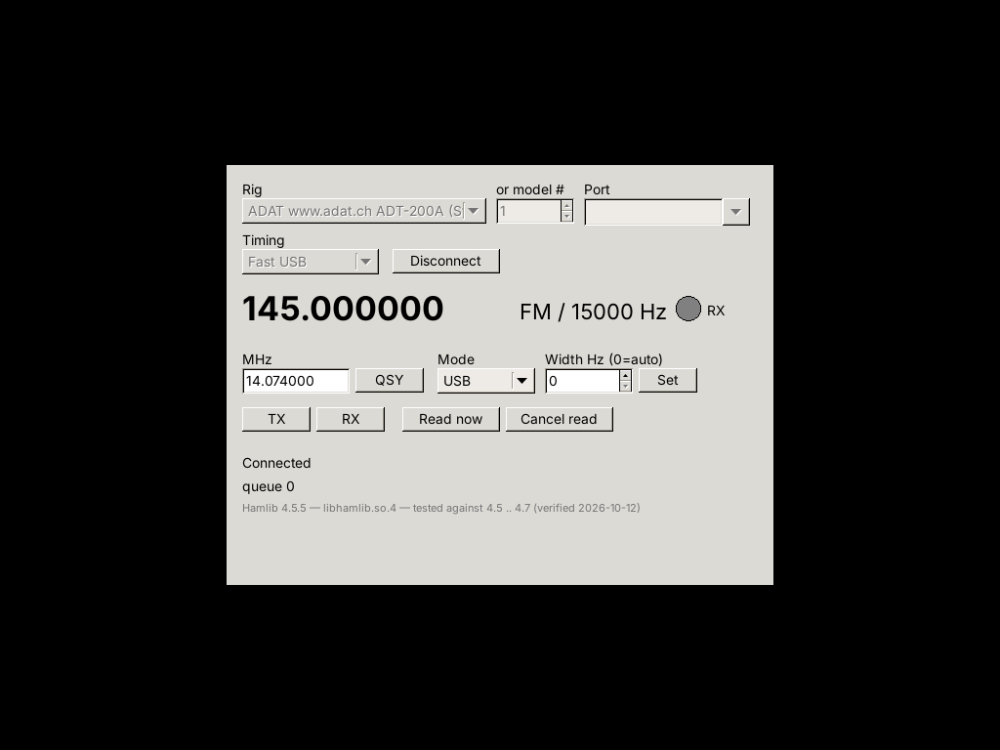
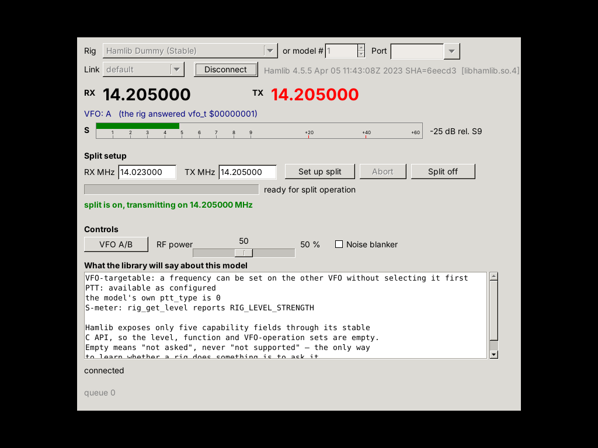

# HamlibComponent 利用ガイド / User's Guide

Rev.6.1 · 2026-10-18

二つのサンプルアプリケーションを教材として、Hamlib の考え方と本
コンポーネントの使い方を説明します。

Explains how to use the component — and the Hamlib concepts behind it —
with the two sample applications as the teaching material.

---

## 目次 / Contents

1. [この文書の読み方](#1-この文書の読み方--how-to-read-this)
2. [5 分で動かす](#2-5-分で動かす--five-minutes-to-a-running-rig)
3. [境界線：Hamlib と本コンポーネントの分担](#3-境界線hamlib-と本コンポーネントの分担--where-the-boundary-is)
4. [中核となる 8 つの概念](#4-中核となる-8-つの概念--the-eight-ideas-that-matter)
5. [サンプル 1：RigPanel で基本操作を読む](#5-サンプル-1rigpanel-で基本操作を読む)
6. [サンプル 2：DxPanel で応用操作を読む](#6-サンプル-2dxpanel-で応用操作を読む)
7. [目的別 API 早見表](#7-目的別-api-早見表--api-by-what-you-want-to-do)
8. [アプリケーション設計の指針](#8-アプリケーション設計の指針--designing-the-application)
9. [落とし穴](#9-落とし穴--the-traps)
10. [トラブルシューティング](#10-トラブルシューティング--troubleshooting)
11. [検証の走らせ方](#11-検証の走らせ方--running-the-verification)

---

## 1. この文書の読み方 / How to read this

本コンポーネントは、Hamlib C ライブラリを Lazarus / Free Pascal から
使うためのラッパーです。しかし「C 関数を Pascal から呼べるようにした
だけ」のものではありません。**非同期化、スレッド分離、ドメイン型への
翻訳、障害時の振る舞い**を引き受けます。したがって使い方を知るには、
関数一覧より先に「何を引き受けていて、何を引き受けていないか」を知る
必要があります。

This component is a wrapper for the Hamlib C library, but not a thin
one. It takes on asynchrony, thread isolation, translation into domain
types, and behaviour under failure. So the useful thing to learn first
is not the function list but **what it takes responsibility for and
what it leaves to you**.

| 読者 | 読む順 |
|---|---|
| とにかく動かしたい | §2 → §7 |
| 設計を理解したい | §3 → §4 → §8 |
| 実例から学びたい | §5 → §6 |
| 動かないので困っている | §9 → §10 |

関連文書 / Related documents:

- `README.md` — インストール、ファイル構成、版ごとの変更
- `COVERAGE_MATRIX.md` — 実アプリが使う Hamlib 機能と本実装の対応表
- `VERIFICATION_REPORT.md` — 検証手法と、見つかった欠陥の記録
- `REV6_REPORT.md` — Rev.6.0 の設計判断

---

## 2. 5 分で動かす / Five minutes to a running rig

### 2.1 必要なもの

```sh
# Debian / Ubuntu
sudo apt install libhamlib-dev libhamlib-utils

# Lazarus でパッケージを開いてコンパイル
# Package → Open Package File → package/HamlibComponent.lpk → Compile
```

実機は不要です。Hamlib の**ダミーリグ（モデル 1）**がシリアルポート
なしで全呼び出しに応答します。

No hardware is needed: Hamlib's **dummy rig (model 1)** answers every
call with no serial port at all.

### 2.2 最小のアプリケーション

```pascal
program Minimal;
{$mode objfpc}{$H+}
uses
  {$IFDEF UNIX}cthreads,{$ENDIF}   // ← Unix では必ず最初に
  Classes, SysUtils,
  HamlibInterfaces, HamlibFactory, HamlibErrors;

type
  THandler = class
    procedure OnFreq(const AResult: TRigFreqResult);
  end;

procedure THandler.OnFreq(const AResult: TRigFreqResult);
begin
  if AResult.Status = rcsSuccess then
    WriteLn(Format('%.6f MHz', [AResult.Freq / 1E6]))
  else
    WriteLn('読めませんでした: ', AResult.ErrorMsg);
end;

var
  Factory: IRigServiceFactory;
  Svc:     IRigService;
  H:       THandler;
  i:       Integer;
begin
  Factory := TRigServiceFactory.Create;
  Svc     := Factory.CreateService;
  H       := THandler.Create;
  try
    Svc.Open(1, '');                        // モデル 1 = ダミーリグ
    Svc.SetFrequencyAsync(14205000);        // 送って
    Svc.GetFrequencyAsync(rvfoCurr, @H.OnFreq);  // 読む

    // コールバックは UI スレッドに届きます。
    // コンソールアプリは自分でポンプを回す必要があります。
    for i := 1 to 100 do
    begin
      CheckSynchronize(5);
      Sleep(5);
    end;

    Svc.Close;
  finally
    H.Free;
    Svc := nil; Factory := nil;             // 解放は参照カウントで
  end;
end.
```

```sh
fpc -Mobjfpc -Sh -Fusrc Minimal.lpr && ./Minimal
# => 14.205000 MHz
```

### 2.3 この 20 行に詰まっている約束事

| 行 | 約束 |
|---|---|
| `cthreads` が最初 | 本コンポーネントは `TThread` を使います。LCL アプリでも必要です（§9.1） |
| `IRigServiceFactory` | ライブラリのロード、バージョンゲート、ローダの共有を担当 |
| `Svc.Open(1, '')` | 空のポートは正当です。ダミーリグはポートを持ちません |
| `SetFrequencyAsync` がすぐ戻る | **全ての rig 操作は非同期**です。戻り値を待ちません |
| `CheckSynchronize` | 結果は `TThread.Queue` で UI スレッドへ届きます |
| `Svc := nil` | `Close` を忘れてもデストラクタが後始末します（§4.7） |

---

## 3. 境界線：Hamlib と本コンポーネントの分担 / Where the boundary is

```
┌─────────────────────────────────────────────────────────┐
│ あなたのアプリケーション                                 │
│   ドメイン型で考える: TRigMode, TRigLevel, TRigErrorKind │
└────────────────────────┬────────────────────────────────┘
                         │ IRigService（非同期・UI スレッド）
┌────────────────────────┴────────────────────────────────┐
│ HamlibComponent                                          │
│   ・ワーカースレッド 1 本に rig ハンドルを閉じ込める      │
│   ・ビットマスク ⇄ ドメイン型の翻訳                      │
│   ・エラーコード → 意味のある種別                        │
│   ・タイムアウト 2 段構え、遮断器、キャンセル            │
│   ・Pull（スナップショット）と Push（イベント）の両立     │
└────────────────────────┬────────────────────────────────┘
                         │ C ABI（同期・ブロッキング）
┌────────────────────────┴────────────────────────────────┐
│ libhamlib                                                │
│   rig_init / rig_open / rig_set_freq / rig_get_level ... │
│   283 のバックエンド（機種ドライバ）                      │
└─────────────────────────────────────────────────────────┘
```

### 引き受けるもの / What the component takes on

| 項目 | 内容 |
|---|---|
| **スレッド** | rig ハンドルに触れるのはワーカー 1 本だけ。アプリは一切ロックを書きません |
| **非同期化** | 遅いシリアル I/O で UI が固まりません |
| **型** | `RIG_MODE_USB`（ビット）ではなく `rmUSB`（列挙値） |
| **エラー** | `-11` ではなく `rekNotAvailable` |
| **機種** | `3085` のハードコードではなく実行時カタログ |
| **寿命** | 参照カウント。`Close` 忘れもデストラクタが吸収 |
| **ABI** | 共有定数を実ヘッダと機械照合（`tools/check_abi.py`） |

### 引き受けないもの / What it leaves to you

| 項目 | 理由 |
|---|---|
| **リグが何に対応しているか** | Hamlib が答えられません（§4.8） |
| **バックエンド固有の癖** | 機種ごとに違い、隠すと嘘になります（§9.2） |
| **操作の順序** | スプリット設定のような多段操作はアプリの責務（§6.2） |
| **コールバック先の寿命** | アプリのオブジェクトはアプリが管理します（§9.5） |

---

## 4. 中核となる 8 つの概念 / The eight ideas that matter

### 4.1 すべての rig 操作は非同期

```pascal
Token := Svc.SetFrequencyAsync(14205000, rvfoCurr, @H.OnDone);
```

呼び出しは**即座に戻ります**。コマンドはキューに積まれ、ワーカー
スレッドが順に実行し、結果は `TThread.Queue` で UI スレッドへ戻ります。

戻り値の `ICancellationToken` は保持しなくても構いません。保持すれば
`Cancel` で中断できます。

```pascal
FPendingRead := Svc.GetFrequencyAsync(rvfoCurr, @H.OnFreq);
// ... 遅すぎるので諦める
if Assigned(FPendingRead) then FPendingRead.Cancel;
```

**キャンセルしても結果は届きます。** `Status` が `rcsCancelled` に
なるだけです。結果が消えることはありません。消えてしまえば、待って
いるアプリは永久に待つことになります。

A cancelled command still reports; only its `Status` changes. A result
that simply vanished would leave its caller waiting forever.

### 4.2 コールバックは UI スレッドに届く

したがってコールバックの中から直接コントロールへ代入できます。ロックは
不要です。本コンポーネントのソース中にアプリ向けのロックが一つも無いのは
このためです。

コンソールアプリだけは自分で `CheckSynchronize` を回す必要があります
（§2.2）。LCL アプリは `Application.Run` が回します。

### 4.3 Pull と Push の二つの読み方

| 方式 | 取得方法 | 向き |
|---|---|---|
| **Push** | `SetOnFrequencyChanged` などのイベント | 変化した瞬間に反応したい |
| **Pull** | `Svc.CurrentState`（I/O なし、即座に返る） | タイマで画面を更新したい |

```pascal
// Pull: タイマから。I/O は起きません。
procedure TMyForm.TimerTick(Sender: TObject);
var S: TRigState;
begin
  S := Svc.CurrentState;
  if S.CurrentFreq > 0 then
    lblFreq.Caption := FormatFloat('0.000000', S.CurrentFreq / 1E6);
end;
```

**`CurrentFreq` と `VfoAFreq` の違いは重要です。**

| フィールド | 誰が埋めるか | 意味 |
|---|---|---|
| `CurrentFreq` | ポーリング | リグが**選択中の VFO** の周波数 |
| `VfoAFreq` / `VfoBFreq` | VFO を明示した読み取りのみ | その VFO の周波数 |

ポーリングは `RIG_VFO_CURR` を尋ね、リグは選択中の VFO について答え、
**それがどの VFO かは告げません**。したがって `VfoAFreq` が 0 なのは
「誰も尋ねていない」であり「未使用」ではありません。

Polling asks for `RIG_VFO_CURR` and the rig answers for whichever VFO
it has selected — never saying which. So 0 in `VfoAFreq` means "nobody
asked", not "unused".

### 4.4 ドメイン型：生の値を扱わない

```pascal
// しない
if RawMode = (Int64(1) shl 1) then ...

// する
if AResult.Mode = rmUSB then ...
```

表示が要るときはコーデックを使います。

```pascal
uses HamlibModeCodec, HamlibLevelCodec, HamlibVfoCodec;

THamlibModeCodec.ToDisplayString(rmUSB)          // 'USB'
THamlibLevelCodec.ToDisplayString(rlvStrength)   // 'S-meter'
THamlibFuncCodec.ToDisplayString(rfnNoiseBlanker)
RigVfoToString(rvfoSub)                          // 'SUB'
```

表示文字列を Hamlib から取らないのは意図的です。C ライブラリから取ると
地域化できず、ライブラリなしに単体テストできず、更新で出力が変わります。

### 4.5 エラーは「種別」で分岐する

```pascal
procedure TMyForm.HandleResult(const AResult: TRigResult);
begin
  if AResult.Status = rcsSuccess then Exit;

  case AResult.Error of
    rekNotAvailable:   ShowNotice('この機種は対応していません');
    rekTimeout:        ShowNotice('リグが応答しません。ケーブルを確認');
    rekRigRejected:    ShowNotice('リグが拒否: ' + AResult.ErrorMsg);
    rekNotConnected:   ShowNotice('接続していません');
    rekCircuitOpen:    ShowNotice('失敗が続いたため通信を停止しました');
  else
    ShowNotice(RigErrorKindToString(AResult.Error) + ': ' + AResult.ErrorMsg);
  end;
end;
```

`TRigErrorKind` が 28 値ある意義は、この `case` 文が書けること自体に
あります。生の `-11` で分岐するアプリは、Hamlib が番号を変えた日に
壊れます。

### 4.6 タイムアウトポリシーは機種特性に合わせる

```pascal
uses HamlibTimeoutPolicy;

Svc.ApplyTimeoutPolicy(RigPolicy_FastUsb);     // USB 直結の現代機
Svc.ApplyTimeoutPolicy(RigPolicy_SlowCat);     // 遅い CAT
Svc.ApplyTimeoutPolicy(RigPolicy_VerySlowCat); // 非常に遅い機種
Svc.ApplyTimeoutPolicy(RigPolicy_Default);     // 迷ったらこれ
```

ポリシーはコマンドタイムアウト、接続タイムアウト、遮断器のしきい値、
ポーリング間隔、周波数変化の検出しきい値をまとめたものです。

**遮断器（circuit breaker）** は、失敗が続いたときに通信を止める仕組み
です。ケーブルが抜けたリグに対してコマンドを投げ続けても意味がなく、
キューが伸びるだけだからです。

```pascal
if Svc.CircuitBreakerOpen then
  lblStatus.Caption := '失敗が続いたため停止中。ケーブルを確認してください';
```

### 4.7 寿命は参照カウント、後始末は自己防衛

```pascal
Svc := Factory.CreateService;
// ... 使う ...
Svc := nil;   // ここで Close も CancelAllPending も DisablePolling も走る
```

`Close` を呼ばずに手放しても、デストラクタが正しい順序で後始末します。
ただし**明示的に `Close` を呼ぶほうが良い**です。デストラクタが走る
タイミングは参照カウント次第で、UI がまだ生きているうちに終わらせたい
からです。

### 4.8 能力問い合わせは「答えられないこと」も答える

```pascal
var Caps: TRigCapabilities;
Caps := Svc.GetCapabilities;

if not Caps.Known then
  // この Hamlib は rig_get_caps_int を公開していません
else
begin
  Caps.TargetableVfo   // 他方の VFO を選択せずに設定できるか
  Caps.PttType         // 機種の静的な ptt_type
  Caps.HasPtt          // 設定された状態で送信できるか
end;
```

**`Caps.GetLevels` などの集合は常に空です。** Hamlib の安定 C API は
5 フィールドしか公開しておらず、どのレベル・機能・VFO 操作に対応して
いるかは含まれません。

> **空は「問い合わせていない」であって「非対応」ではありません。**
> 集合が空だからとコントロールを隠すアプリは、実際には動くコントロール
> を隠すことになります。

リグがある機能に対応するかを確実に知る唯一の方法は、**尋ねてエラーを
読む**ことです。`rekNotAvailable` がその答えです。

---

## 5. サンプル 1：RigPanel で基本操作を読む

`demo/` にあります。単一 VFO のリグ制御パネルで、**独立したコマンド**
だけを扱います。周波数を設定する、モードを読む、PTT を押す。各々が単独で
成否を決め、中途半端に残るものはありません。



```sh
cd demo
lazbuild RigPanel.lpi
./RigPanel --model=1 --port=      # ダミーリグに自動接続
```

### 5.1 ファイル構成が示すもの

| ファイル | 行数 | 役割 |
|---|---|---|
| `RigPanelView.pas` | 121 | `IRigView` — 画面が「できること」。LCL の名前は一つも出ません |
| `RigPanelPresenter.pas` | 817 | 振る舞いのすべて。LCL 非依存 |
| `MainForm.pas` | 560 | コントロール配置とイベント転送だけ |
| `ScenarioTest.lpr` | 903 | presenter をテストダブルで駆動（画面なしで 43 検査） |

これは **MVP Passive View** です。`presenter` が「何を見せるか」を決め、
`view` は表示するだけ。実務上の帰結は 2 つあります。

1. presenter を**画面なしでテストできる**（`ScenarioTest`）
2. フォームにロジックが溜まらない。許されているのは代入とイベント転送だけ

### 5.2 接続：ライブラリのロードから

```pascal
procedure TRigPresenter.Initialise;
begin
  try
    FCatalog := FFactory.CreateModelCatalog;   // ← ここでライブラリがロードされる
  except
    on E: EHamlibUnsupportedVersion do         // ← バージョンゲートが発火
      ...
    on E: EHamlibLoadError do                  // ← ライブラリが見つからない
      ...
  end;

  if FCatalog.IsAvailable then
    for i := 0 to FCatalog.Count - 1 do
      Items[i] := RigModelInfoToString(FCatalog.Items[i]);
end;
```

**機種番号をハードコードしません。** カタログを実行時に構築し、
操作者が選びます。列挙できないビルドでは番号入力に退きます（機能低下で
あって故障ではありません）。

**バージョンゲートはシリアルポートに触れる前に発火します。** 検証済み
範囲外の Hamlib は、既定では拒否されます。

```pascal
Factory.AllowUntestedVersion := True;   // 新しい Hamlib でも動かしたい場合
```

### 5.3 周波数・モード・PTT

```pascal
// 送る（コールバックなし = エラーは OnError へ）
Svc.SetFrequencyAsync(AHz);

// 読む（コールバックあり）
FPendingRead := Svc.GetFrequencyAsync(rvfoCurr, @HandleFreqRead);

// モードは帯域幅とセット。0 は「リグの既定」
Svc.SetModeAsync(rmUSB, 2400, rvfoCurr, @HandleSetDone);

// PTT
Svc.SetPttAsync(rpttOn);
Svc.SetPttAsync(rpttOff);
```

`rmUnknown` は**リグが報告した、名前を持たないモード**を意味します。
設定には使えません（拒否されます）。無視せず処理すべき値です。

### 5.4 このサンプルが見つけた欠陥

RigPanel を作ったこと自体が検査でした。どのユニットテストも到達して
いなかった欠陥を 5 件見つけています。たとえば：

- `rigerror()` が 15 KB のデバッグバッファを返していた（`rigerror2()` を使うべきだった）
- `Open(model, 'none')` が失敗していた（`'none'` はネットワークホスト名として解決される）
- 接続失敗後の全コマンドが、本当の原因ではなく「失敗が続いたため休止」と報告していた

詳細は `REV5_REPORT.md` 第 9 章。

---

## 6. サンプル 2：DxPanel で応用操作を読む

`demo2/` にあります。意図的に「2 つ目の RigPanel」にしていません。
RigPanel が扱わなかった形 — **途中で失敗しうる多段操作** — を軸に
しています。



```sh
cd demo2
lazbuild DxPanel.lpi
./DxPanel --model=1 --port= --setup=14.023,14.205
```

### 6.0 ファイル構成

| ファイル | 行数 | 役割 |
|---|---|---|
| `DxPanelView.pas` | 154 | `IDxView` — スプリット・メータ用の画面インターフェース |
| `DxSplitSequence.pas` | 713 | **ロールバック可能な多段操作**。view も LCL も知りません |
| `DxPanelPresenter.pas` | 824 | 振る舞いのすべて。LCL 非依存 |
| `DxMainForm.pas` | 759 | コントロール配置、イベント転送、S メータの描画 |
| `DxConformanceTest.lpr` | 907 | 記録用 view で実ライブラリに対して駆動（64 検査） |

RigPanel との違いは `DxSplitSequence.pas` の存在です。**「何を、いつ、
取り消すべきか」が名前の付いた一箇所にある**ことが、このサンプルの要点
です（§6.2）。

### 6.1 画面が示す Hamlib の機能

| 画面要素 | Hamlib 機能 | コンポーネント API |
|---|---|---|
| RX / TX 大表示 | `rig_get_freq` / `rig_get_split_freq` | `GetFrequencyAsync` / `GetSplitAsync` |
| VFO 行（生の vfo_t 併記） | `rig_get_vfo` | `GetVfoAsync` → `TRigVfoResult.RawVfo` |
| S メータ（自前描画） | `rig_get_level(RIG_LEVEL_STRENGTH)` | `GetLevelAsync(rlvStrength)` |
| スプリット設定 | `rig_set_vfo` + `rig_set_freq` + `rig_set_split_vfo` + `rig_set_split_freq` | `DxSplitSequence` |
| VFO A/B ボタン | `rig_vfo_op(RIG_OP_TOGGLE)` | `VfoOpAsync(rvoToggle)` |
| RF 出力スライダ | `rig_set_level(RIG_LEVEL_RFPOWER)` | `SetLevelFloatAsync(rlvRfPower, 0..1)` |
| ノイズブランカ | `rig_set_func(RIG_FUNC_NB)` | `SetFuncAsync(rfnNoiseBlanker, ...)` |
| 能力パネル | `rig_get_caps_int` | `GetCapabilities` |

### 6.2 中心にあるもの：ロールバック可能なシーケンス

DX 局と交信するには、4 つのコマンドから組み立てた状態にリグを置きます。

```
1. VFO A を選択              rig_set_vfo(VFO_A)
2. VFO A の周波数を設定       rig_set_freq(VFO_A, rx)     ← DX 局の送信周波数
3. スプリットを有効化         rig_set_split_vfo(1, VFO_B)
4. 送信周波数を設定           rig_set_split_freq(tx)      ← 自分が呼ぶ場所
5. 読み戻して確認             rig_get_split_vfo + freq
```

**手順には順序があり、どれも失敗しえます。** 危険なのは手順 3 の後に
失敗した場合です。リグはスプリットのまま、送信周波数は未設定で残り、
次に送信したとき**自分が選んでいない周波数で電波を出します**。

`DxSplitSequence.pas` はこれを一つの単位として扱い、有効化の後に失敗
したらスプリットを解除してから失敗を報告します。

```pascal
Seq := TDxSplitSequence.Create(Svc);
Seq.OnProgress := @HandleProgress;   // 「3 / 5 スプリット有効化中」
Seq.OnFinished := @HandleFinished;   // 成否と、ロールバックが走ったか
if not Seq.Start(14.023 * 1E6, 14.205 * 1E6) then
  // 実行中・未接続・周波数が不正 のいずれか（例外ではなく戻り値）
```

#### なぜ状態機械で書くか

FPC 3.2.2 に匿名メソッドはありません。入れ子のコールバック連鎖で書くと
「次を呼ぶ名前付きメソッド 5 つ」になり、**順序はコード中の経路として
しか存在しなくなります**。それは「手順 3 を取り消し忘れていないか」が
読んでは答えられない形です。

`DxSplitSequence` では、順序が存在するのは `Advance()` 一箇所だけ、
各ステップハンドラはガードと結果判定のみ、取り消すべき事実は
`FSplitEnabled` 一つが記録します。

#### 遅れて届くコールバックへのガード

```pascal
procedure TDxSplitSequence.HandleRxFreqSet(const AResult: TRigResult);
begin
  if FStep <> dxsSetRxFreq then Exit;   // ← 自分のステップか確認
  ...
end;
```

キューに入ったコマンドは取り消せません。`Abort` はトークンをキャンセル
しますが、結果は届きます。このガードがないと、**中断したシーケンスが
黙って再開します**。操作者がまさに最悪の瞬間に中断したときにだけ現れる
欠陥です。

### 6.3 レベル：float と整数の区別

`value_t` は **16 バイトの C 共用体**で、値渡しされます。整数レベルを
float として読むと、エラーではなく**数億という一見もっともらしい値**に
なります。

```pascal
procedure TDxPresenter.HandleStrength(const AResult: TRigLevelResult);
begin
  if AResult.Status <> rcsSuccess then Exit;   // 多くのリグは ENAVAIL を返す

  if AResult.IsFloat then                       // ← 共用体のどちら側か
    FLastDb := Round(AResult.FloatValue)
  else
    FLastDb := AResult.IntValue;                // S メータは整数 dB
end;
```

設定側は**呼び分けます**。間違えると引数検証で弾かれます。

```pascal
Svc.SetLevelFloatAsync(rlvRfPower, 0.42);   // 0.0〜1.0 の float レベル
Svc.SetLevelIntAsync(rlvKeySpeed, 27);      // WPM の整数レベル

Svc.SetLevelIntAsync(rlvRfPower, 1);        // → EArgumentException
Svc.SetLevelFloatAsync(rlvStrength, 0.5);   // → EArgumentException（メータは読み取り専用）
```

`rlvStrength` は **S9 を基準とした dB** です。0 = S9、−54 ≒ S0、
+20 = S9+20dB。`0` は「未取得」ではなく正当かつ強い値なので、
`TRigState.HasStrength` で区別します。

### 6.4 メータのバックプレッシャ

```pascal
procedure TDxPresenter.MeterTick;
begin
  if Assigned(FSequence) and FSequence.Active then Exit;  // 多段操作中は読まない
  if FMeterPending then Exit;                             // 前の読みが戻るまで出さない
  if Svc.CircuitBreakerOpen then Exit;

  FMeterPending := True;
  Svc.GetLevelAsync(rlvStrength, @HandleStrength);
end;
```

これがないとパネルは**要求生成器**になります。タイマは 250 ms ごとに
発火し、シリアル接続のリグは 150 ms かかり、リンクが一度詰まればキューは
詰まっている間ずっと伸び続けます。コンポーネントは耐えます（キューは
有界で遮断器が働く）が、操作者は次のコマンドが動くまでに古いメータ
読み取り 100 件の消化を待つことになります。

**メータにとってティックを捨てるのが正しい振る舞いです。** 最新の値だけ
が意味を持ちます。

### 6.5 conf トークン：Open の前に

```pascal
Svc.AddConfToken('ptt_type', 'RIG');   // ← Open より前。後だと例外
Svc.Open(AModel, APort);
```

WSJT-X と fldigi はどちらも `ptt_type` を設定します。機種の既定値が、
実際の配線と異なることが多いからです。

コンポーネントはトークンを**ポート設定の後、自身のタイムアウトの前**に
適用します。たまたまタイミングに触れるトークンが、今選んだポリシーを
黙って上書きしないようにするためです。

### 6.6 このサンプルが見つけた欠陥

DxPanel も作ったこと自体が検査でした。

- **スナップショットが、告げられていない事実を主張していた。** ポーラの
  読み値を `VfoAFreq` に格納していたため、VFO B を選択していると
  **VFO B の周波数が VFO A のものとして報告**されていました。単一 VFO の
  パネルでは見えず、スプリットでは「聞いている周波数」と「送信している
  周波数」が誤ったラベルの下に出ます。→ `CurrentFreq` を新設（§4.3）
- 失敗しえないテスト（記録するだけで参照しないフラグ）

詳細は `REV6_REPORT.md` 第 4 章。

---

## 7. 目的別 API 早見表 / API by what you want to do

### 7.1 uses 節

```pascal
uses
  HamlibInterfaces,     // 型、IRigService、TRigMode、TRigErrorKind   ← 必須
  HamlibFactory,        // TRigServiceFactory                        ← 必須
  HamlibErrors,         // 例外クラス、RigErrorKindToString
  HamlibTimeoutPolicy,  // RigPolicy_FastUsb など
  HamlibModeCodec,      // モード表示文字列
  HamlibLevelCodec,     // レベル・機能の表示文字列
  HamlibVfoCodec,       // RigVfoToString、RigVfoSelectionMatches
  HamlibCatalog;        // RigModelInfoToString
```

`uses HamlibComponent` だけでは何も見えません。Object Pascal に推移的な
可視性はないからです。

### 7.2 操作

| したいこと | 呼ぶもの | 結果型 |
|---|---|---|
| 周波数を設定 | `SetFrequencyAsync(Hz, AVfo, cb)` | `TRigResult` |
| 周波数を読む | `GetFrequencyAsync(AVfo, cb)` | `TRigFreqResult` |
| モードを設定 | `SetModeAsync(AMode, APassbandHz, AVfo, cb)` | `TRigResult` |
| モードを読む | `GetModeAsync(AVfo, cb)` | `TRigModeResult` |
| 送信 | `SetPttAsync(rpttOn / rpttOff, cb)` | `TRigResult` |
| S メータ・レベルを読む | `GetLevelAsync(ALevel, cb, AVfo)` | `TRigLevelResult` |
| float レベルを設定 | `SetLevelFloatAsync(ALevel, 0..1, cb, AVfo)` | `TRigResult` |
| 整数レベルを設定 | `SetLevelIntAsync(ALevel, N, cb, AVfo)` | `TRigResult` |
| 機能を読む | `GetFuncAsync(AFunc, cb, AVfo)` | `TRigFuncResult` |
| 機能を設定 | `SetFuncAsync(AFunc, Bool, cb, AVfo)` | `TRigResult` |
| スプリット有効化 | `SetSplitAsync(True, **ATxVfo 必須**, cb)` | `TRigResult` |
| スプリット解除 | `SetSplitAsync(False, rvfoCurr, cb)` | `TRigResult` |
| スプリット状態を読む | `GetSplitAsync(cb)` | `TRigSplitResult` |
| 送信周波数を設定 | `SetSplitFreqAsync(Hz, cb)` | `TRigResult` |
| VFO を選択 | `SetVfoAsync(AVfo, cb)` | `TRigResult` |
| VFO を読む | `GetVfoAsync(cb)` | `TRigVfoResult` |
| VFO 操作 | `VfoOpAsync(AOp, cb, AVfo)` | `TRigResult` |

### 7.3 問い合わせ（I/O なし・即座に返る）

```pascal
Svc.IsOpen              : Boolean
Svc.CurrentState        : TRigState
Svc.LibraryStatus       : TRigLibraryStatus
Svc.QueueDepth          : Integer
Svc.CircuitBreakerOpen  : Boolean
Svc.GetCapabilities     : TRigCapabilities
Svc.GetCurrentPolicy    : TRigTimeoutPolicy
```

これらは**閉じている状態でも例外を出しません**。UI の更新をすべて
`try/except` に押し込めないためです。

### 7.4 イベント

```pascal
Svc.SetOnConnectionChanged(@HandleConnectionChanged);  // (Sender; AConnected: Boolean)
Svc.SetOnFrequencyChanged(@HandleFrequencyChanged);    // (Sender; AFreq: Double)
Svc.SetOnError(@HandleError);                          // (Sender; AKind; ANativeCode; AMsg)
Svc.SetOnLibraryWarning(@HandleLibraryWarning);        // (Sender; AStatus; AMessage)
```

`OnError` に届くのは**自前のコールバックを持たない失敗だけ**です。
コールバック付きで発行したコマンドの失敗はそちらへ行きます。

### 7.5 例外（引数・状態の誤り）

| 例外 | いつ |
|---|---|
| `EArgumentException` | 引数が不正（`rvfoCurr` を送信 VFO に、など） |
| `ERigServiceClosed` | 未接続でコマンドを発行 |
| `ERigServiceOpen` | 接続中に再度 `Open` |
| `EHamlibLoadError` | ライブラリが見つからない |
| `EHamlibUnsupportedVersion` | バージョンゲート |
| `ERigModelUnknown` | ライブラリがその機種を知らない |
| `ERigError` | リグ由来の失敗（`.Kind` と `.Code` を持つ） |

**リグの失敗は例外ではなく結果（`Status`）で届きます。** 例外になるのは
**プログラムの誤り**だけです。この区別が、アプリの `try` の量を決めます。

---

## 8. アプリケーション設計の指針 / Designing the application

### 8.1 MVP Passive View

両サンプルが従う構造です。

```
View（フォーム）     ← 代入とイベント転送のみ。判断しない
   ↑ IxxxView（「これを表示せよ」だけ。問い合わせメソッドを持たない）
Presenter            ← 振る舞いのすべて。LCL 非依存 = 画面なしでテスト可
   ↓ IRigService
HamlibComponent
```

**view に問い合わせメソッドを置かないでください。** 問い合わせ可能な
view は、presenter が UI から状態を読み戻すことを誘発します。それが
Passive View が受動でなくなる経路です。

### 8.2 view インターフェースは用途ごとに分ける

`IRigView`（単一 VFO）と `IDxView`（スプリット・メータ）は別物です。
両方を覆うよう一つに広げると、RigPanel は**実装するだけで決して呼ばない
メソッド**を持つことになります。コンポーネント自身が
`IHamlibDiagnostics` / `IHamlibCatalog` / `IHamlibRigControl` の分割で
避けている Interface Segregation 違反です。

### 8.3 終了処理の順序

```pascal
procedure TMyForm.FormCloseQuery(Sender: TObject; var CanClose: Boolean);
begin
  tmrMeter.Enabled := False;      // 1. タイマを止める
  tmrState.Enabled := False;
  FPresenter.Disconnect;          // 2. presenter 経由で切断
  CanClose := True;
end;
```

タイマを先に止めるのは、ティックが解放済みオブジェクトを呼ばないため
です。`Disconnect` をデストラクタではなく `FormCloseQuery` で行うのは、
`Close` が、LCL がまだキュー済みコールバックを配送できるうちに走る
ようにするためです。

### 8.4 フォームが `IxxxView` を実装するときの参照カウント

```pascal
function TMyForm._AddRef: LongInt; cdecl;  begin Result := -1; end;
function TMyForm._Release: LongInt; cdecl; begin Result := -1; end;
```

`TForm` の寿命は参照カウントではなく**所有者**に属します。presenter に
インターフェースを渡すことで presenter を所有者にしてはなりません。

---

## 9. 落とし穴 / The traps

### 9.1 `cthreads` を最初に（Unix）

```pascal
uses
  {$IFDEF UNIX}cthreads,{$ENDIF}
  Interfaces, Forms, ...
```

**LCL アプリでも必要です。** 「ウィジェットセットが引き込むから不要」は
誤りで、Lazarus 3.0 / FPC 3.2.2 の gtk2 では起動時に
`Runtime error 232` で停止します。組み合わせによっては偶然リンクされ
ますが、それに頼ると「自分の環境では起動し、利用者の環境では起動しない」
アプリを出荷することになります。

### 9.2 Hamlib 側の既知の癖（隠していません）

| 癖 | 内容 |
|---|---|
| **VFO の正規化** | `rig_set_vfo(VFO_B)` の後 `rig_get_vfo` は **SUB** と答えます。`=` 比較は誤り。`RigVfoSelectionMatches(rvfoB, Got)` を使います |
| **ダミーの split_freq** | `rig_set_split_freq` がダミーリグでは**選択中の VFO** を動かします（`rig.c` が解決済み tx_vfo ではなく呼び出し側の vfo を渡すため） |
| **`rig_get_caps_int`** | 機種の**静的な**能力表を読みます。conf トークンは反映されません |
| **`rigerror()`** | 蓄積されたデバッグバッファ（実測 15 KB）を返します。本コンポーネントは `rigerror2()` を使います |
| **`'none'` ポート** | ネットワークホスト名として解決されます。**空文字列**を使ってください |
| **S メータの揺れ** | ダミーリグは `time(NULL) % 32 + rand() % 4` を加えます（コメント: "make S-Meter jiggle"） |

```pascal
// VFO の確認はこう書く
if RigVfoSelectionMatches(rvfoB, AResult.Vfo) then ...
// 本当に特定の受信機を指したいときだけ rvfoMain / rvfoSub を厳密比較
```

### 9.3 `SetSplitAsync(True)` に送信 VFO は必須

```pascal
Svc.SetSplitAsync(True);                 // → EArgumentException
Svc.SetSplitAsync(True, rvfoB);          // 正しい
```

`ATxVfo` の既定値は `rvfoCurr` ですが、有効化時にそれを渡すことは
「**今受信している VFO で送信せよ**」をリグに告げることです。それは
スプリットではなく、DX 局自身の周波数で送信することです。Rev.6.1 から
拒否されます。

解除時は既定値のままで構いません（既存の指名が保たれます）。

### 9.4 空の能力集合を「非対応」と読まない

§4.8 のとおりです。`rlvStrength in Caps.GetLevels` が False でも、
`GetLevelAsync(rlvStrength)` は成功しえます。

### 9.5 コールバック先の寿命はアプリの責務

コンポーネントはアプリのオブジェクトを所有しません。結果が届く前に
コールバックの持ち主を解放すると、解放済みメモリのメソッドが呼ばれます。

```pascal
// 安全な形：トークンを保持し、破棄前にキャンセル
destructor TMyController.Destroy;
begin
  if Assigned(FPending) then FPending.Cancel;
  FPending := nil;
  inherited;
end;
```

キャンセルしても結果は届きますが、**届く先が生きていること**は
アプリが保証します。

### 9.6 サービスを接続ごとに作り直さない

```pascal
// 望ましい：一つの Service を Close / Open で使い回す
Svc.Close;
Svc.Open(AModel, APort);

// 避ける：接続のたびに作り直す
Svc := nil;
Svc := Factory.CreateService;   // ← ファクトリを共有していれば安全だが
```

ファクトリは Rev.6.1 からローダを共有するため、同じファクトリから作る
限り安全です。ファクトリごと作り直すと、Hamlib がバックエンド表を
再登録し、そのたび 4,528 バイトが libhamlib 内部に残ります
（`rig_load_all_backends` が表を memset してから再確保するため。
Hamlib 側の仕様で、呼び出し側からは「2 回呼ばない」以外に回避手段が
ありません）。

---

## 10. トラブルシューティング / Troubleshooting

| 症状 | 原因と対処 |
|---|---|
| 起動直後に `Runtime error 232` | `cthreads` が無いか最初でない（§9.1） |
| `EHamlibLoadError` | `libhamlib-dev` 未インストール。Windows では PATH 上の誤った DLL。`LibraryStatus.LibPath` で実際にロードしたファイルを確認 |
| `EHamlibUnsupportedVersion` | 検証済み範囲外。`Factory.AllowUntestedVersion := True` で続行可（自己責任） |
| コールバックが届かない | コンソールアプリで `CheckSynchronize` を回していない（§2.2） |
| `CurrentState.Connected` が False のまま | Rev.6.0 以前の不具合。Rev.6.1 では `Open` が同期的に記録します |
| 周波数表示が送信側になる | `VfoAFreq` ではなく `CurrentFreq` を読んでください（§4.3） |
| `rekNotAvailable` ばかり返る | その機種がその機能に非対応。能力集合は空なので、これが唯一の答え方です |
| 「失敗が続いたため休止」 | 遮断器が開いています。`CircuitBreakerOpen` を確認し、切断してケーブルを確認 |
| S メータが 0 dB のまま | 0 dB は S9 です。未取得は `HasStrength = False` で区別します |
| VFO の確認が常に失敗する | `=` ではなく `RigVfoSelectionMatches` を使う（§9.2） |
| 多段操作が途中で止まる | `OnFinished` のメッセージに失敗したステップ名が入ります |

### ライブラリの出自を確認する

```pascal
with Svc.LibraryStatus do
  WriteLn(Format('%s  [%s]  範囲 %s', [VersionText, LibPath, SupportedRange]));
```

Windows では PATH 上の誤った DLL がよくある、かつ分かりにくい失敗の原因
です。接続後に一度表示しておくと診断が早くなります。

---

## 11. 検証の走らせ方 / Running the verification

```sh
# 全ユニットテスト（アサーション・範囲検査・リーク検出つき）
cd test
for t in *.lpr; do
  fpc -Mobjfpc -Sh -Sa -Criot -gh -Fu../src -FE. $t && ./${t%.lpr}
done

# ABI 定数を実ヘッダと照合（4 リファレンス）
python3 tools/check_abi.py

# 層依存のフィットネス関数
python3 tools/check_layers.py

# Hamlib 自身の rigctld との差分テスト
fpc -Mobjfpc -Sh -Sa -Criot -gh -Fusrc -FEout test/DifferentialTest.lpr
python3 tools/differential.py --binary ./out/DifferentialTest

# ランダム化テスト（失敗時はシードが表示され、再現できます）
./out/RandomSequenceTest 42 3000
```

`-Sa` はアサーション、`-Criot` は範囲・オーバーフロー検査、`-gh` は
リークトレースです。全テストがこれらのフラグ下で**未解放ブロック 0** で
通ります。

検証手法の選定理由と、見つかった 9 件の欠陥の記録は
`VERIFICATION_REPORT.md` にあります。

---

## 付録：まだ検証されていないこと / Appendix: what is not verified

利用にあたって知っておくべき限界です。

- **実機での検証はありません。** すべて Hamlib のダミーバックエンドか、
  その前段の `rigctld` に対して実行しています。シリアルのタイミング、
  CI-V バスの競合、機種固有の癖は未検査です。
- **第 1 段タイムアウトはハードウェアなしに検証できません。** ダミー
  リグが答えないことはないからです。
- **ウォッチドッグのスレッド跨ぎ `rig_close`** は、スレッド閉じ込めの
  唯一の文書化された例外であり、意図的に記録されたリスクです。
- **単一プラットフォーム**（Linux / FPC 3.2.2 / x86-64）。Windows と
  macOS は未検査です。
- **`rig_get_conf` は未実装**です（`COVERAGE_MATRIX.md` §4.1）。
